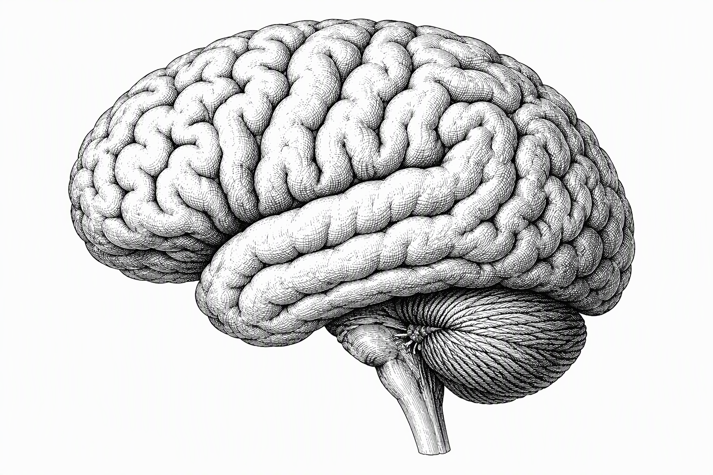

<div align="center">

# Reassessing the Transferred-Potential Hypothesis

### Syntergic Theory, Isolated-Brain EEG Evidence, and Reproducible Tests

**Thor Thor · Independent Open-Source Researcher**

[](https://doi.org/10.5281/zenodo.23652517)
[](https://github.com/codethor0/grinberg-transferred-potential/actions/workflows/verify.yml)
[](LICENSE.md)
[](LICENSE.md)



**[Read the paper](manuscript/Grinberg_Transferred_Potential_Research_Paper.pdf) · [Zenodo record](https://zenodo.org/records/23652517) · [Reproduce the benchmark](reproducibility/README.md)**

</div>

## About this research

Jacobo Grinberg-Zylberbaum's transferred-potential hypothesis remains experimentally testable, but the available evidence does **not** establish a reliable new brain-to-brain communication mechanism.

This independent preprint provides a source-traced critical methodological review, separates the original transferred-waveform claim from related inter-brain findings, and supplies an executable synthetic null benchmark plus a proposed preregistered multi-laboratory protocol. It reports no new human EEG experiment and no demonstrated anomalous communication.

## What the synthetic benchmark shows

Using 5,000 independent synthetic signal pairs per frequency condition:

| Frequency band | Naive Pearson rejection rate | Circular-shift rejection rate |
| --- | ---: | ---: |
| 13–35 Hz | 43.28% | 4.54% |
| 4–12 Hz | 62.06% | 5.08% |

These are synthetic methodological results—not human EEG findings. They illustrate why analytical dependence and appropriate null calibration matter when evaluating transferred-potential evidence.

## Read and cite

- **[Final PDF](manuscript/Grinberg_Transferred_Potential_Research_Paper.pdf)** — 38-page published manuscript.
- **[Editable DOCX](manuscript/Grinberg_Transferred_Potential_Research_Paper.docx)** — native Word equations.
- **[Markdown source](manuscript/Manuscript_Source.md)** — canonical text, mathematics, references, and appendices.
- **[Verification report](VERIFICATION_REPORT.md)** — numerical, structural, visual, and package-integrity results.
- **[Audit disposition](AUDIT_DISPOSITION.md)** — disposition of all 46 independent-audit findings.

```bibtex
@misc{thor2026transferredpotential,
  author    = {Thor, Thor},
  title     = {Reassessing the Transferred-Potential Hypothesis: Syntergic Theory, Isolated-Brain EEG Evidence, and Reproducible Tests},
  year      = {2026},
  publisher = {Zenodo},
  doi       = {10.5281/zenodo.23652517},
  url       = {https://doi.org/10.5281/zenodo.23652517}
}
```

## Reproduce

```sh
python -m pip install -r reproducibility/requirements_executed.txt
python reproducibility/synthetic_null_demo.py
```

To regenerate the benchmark, figures, and manuscript PDF:

```sh
sh reproducibility/run_all.sh
```

See [reproducibility/README.md](reproducibility/README.md) for dependencies, expected outputs, interpretation limits, and the Word-build boundary. Automated verification runs on every push to `main` and every pull request.

## Repository map

| Path | Contents |
| --- | --- |
| `manuscript/` | Published PDF, editable DOCX, and canonical Markdown |
| `figures/` | Nine original figures in PNG and PDF formats |
| `cover/` | Black-and-white brain cover illustration |
| `reproducibility/` | Benchmark, figure and document builders, outputs, and verifier |
| `metadata/` | Deposit metadata |
| `SHA256SUMS.txt` | File-level integrity manifest |

## License and research boundaries

Manuscript, figures, cover, documentation, and synthetic outputs: **CC BY 4.0**. Original code: **MIT**. See [LICENSE.md](LICENSE.md) and [RIGHTS_MANIFEST.md](RIGHTS_MANIFEST.md).

This is an independent preprint, not a journal-peer-reviewed article. No third-party source PDFs, private research bundles, raw human EEG, or participant data are included.
